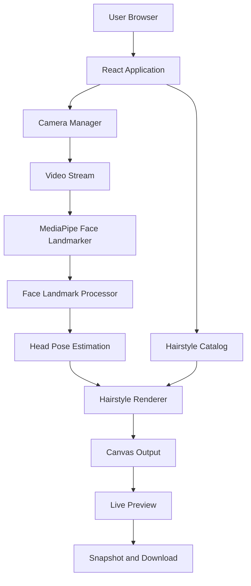

# AI HAIRSTYLE TRY-ON
## Product Planning, MVP Specification, Technical Architecture & Development Roadmap

**Document Version:** 1.0
**Status:** Draft – Awaiting Approval
**Development Phase:** Pre-Development
**Product Type:** AI-Powered Web Application
**Primary Mode:** Live Camera Virtual Try-On
**Target Audience:** Men & Women
**Platform:** Responsive Web Application

---

# 1. PRODUCT VISION

## 1.1 Product Overview

AI Hairstyle Try-On adalah aplikasi web yang memungkinkan pengguna mencoba berbagai gaya rambut secara virtual melalui kamera secara real-time.

Pengguna dapat melihat simulasi berbagai potongan rambut pada wajah mereka tanpa perlu benar-benar memotong atau mengubah rambut.

Aplikasi menggunakan teknologi computer vision, face landmark detection, head tracking, dan hairstyle rendering untuk menghasilkan pengalaman virtual try-on.

## 1.2 Vision Statement

"Help everyone discover their best hairstyle through accessible, realistic, and intelligent virtual experiences."

## 1.3 Problem Statement

Masalah yang ingin diselesaikan:

1. Pengguna kesulitan menentukan potongan rambut yang cocok dengan wajah mereka.
2. Referensi foto model rambut tidak selalu memberikan gambaran hasil pada wajah pengguna.
3. Pengguna khawatir salah memilih potongan rambut.
4. Konsultasi dengan barber atau hairstylist belum tentu memberikan visualisasi hasil akhir.
5. Mencari model rambut yang cocok membutuhkan banyak percobaan.

## 1.4 Product Goals

- Memungkinkan pengguna mencoba model rambut secara real-time.
- Mendukung berbagai bentuk wajah dan karakteristik rambut.
- Memberikan katalog hairstyle yang terorganisasi.
- Membantu pengguna menemukan gaya rambut yang sesuai.
- Memberikan pengalaman yang mudah digunakan melalui browser.
- Menjadi fondasi untuk pengembangan AI personal appearance platform.

## 1.5 Target Users

- Pengguna pria dan wanita.
- Pengguna yang ingin mengganti gaya rambut.
- Pengguna yang sedang mencari referensi potongan rambut.
- Pengguna yang ingin berkonsultasi sebelum ke barber atau salon.
- Barber dan hairstylist sebagai calon pengguna profesional pada masa depan.

## 1.6 Product Principles

1. Real-time first.
2. User privacy first.
3. Simple and intuitive interface.
4. Realistic visualization over unnecessary effects.
5. Modular and scalable architecture.
6. Performance on mobile devices.
7. AI recommendations must be explainable and not presented as absolute judgments.

---

# 2. PRODUCT SCOPE

## 2.1 Main Modules

| Module | Description |
|---|---|
| Camera System | Mengakses kamera pengguna |
| Face Detection | Mendeteksi wajah |
| Face Landmark | Mengidentifikasi titik-titik wajah |
| Head Tracking | Mengikuti gerakan kepala |
| Hairstyle Rendering | Menampilkan model rambut virtual |
| Hairstyle Catalog | Menyediakan katalog gaya rambut |
| Face Shape Analysis | Mengestimasi bentuk wajah |
| Hairstyle Recommendation | Memberikan rekomendasi |
| Preview Controls | Mengatur tampilan simulasi |
| Save & Download | Menyimpan hasil simulasi |

## 2.2 Hairstyle Categories

Katalog harus mendukung kategori berdasarkan karakteristik gaya, bukan hanya berdasarkan gender.

### Short Hair
- Buzz Cut
- Crew Cut
- French Crop
- Textured Crop
- Pixie Cut
- Short Bob

### Medium Hair
- Two Block
- Side Part
- Curtains
- Wolf Cut
- Layered Medium Hair
- Shag

### Long Hair
- Long Layers
- Straight Long Hair
- Wavy Long Hair
- Long Bob
- Butterfly Cut

### Curly & Wavy
- Curly Crop
- Curly Fringe
- Curly Bob
- Wavy Layers

### Additional Variations
- Hair color.
- Hair volume.
- Hair length.
- Hair texture.

Ketersediaan masing-masing variasi bergantung pada aset yang sudah divalidasi.

## 2.3 Product Boundaries

Produk ini berfokus pada simulasi rambut.

Fitur pakaian, celana, sepatu, tas, dan aksesori merupakan kemungkinan pengembangan platform yang lebih luas, bukan bagian dari MVP proyek ini.

---

# 3. USER EXPERIENCE & USER FLOW

## 3.1 Main User Journey

1. Pengguna membuka website.
2. Pengguna masuk ke halaman utama.
3. Pengguna memilih Start Virtual Try-On.
4. Website meminta izin kamera.
5. Kamera aktif.
6. Sistem mendeteksi wajah.
7. Sistem melakukan face landmark tracking.
8. Pengguna memilih hairstyle.
9. Hairstyle ditampilkan pada kepala pengguna.
10. Pengguna mencoba gaya lainnya.
11. Pengguna dapat mengambil snapshot.
12. Pengguna dapat membandingkan dan mengunduh hasil.

## 3.2 Camera States

Sistem harus memiliki beberapa kondisi:

- Camera not initialized.
- Camera permission requested.
- Camera permission denied.
- Camera initializing.
- Camera active.
- Face not detected.
- Multiple faces detected.
- Face tracking active.
- Tracking lost.
- Camera stopped.
- Camera device unavailable.

Setiap kondisi harus memiliki tampilan dan penanganan kesalahan yang jelas.

## 3.3 Interaction Design

Pengguna dapat:

- Mengganti hairstyle tanpa menghentikan kamera.
- Melihat perubahan secara langsung.
- Mengubah posisi dan ukuran simulasi jika diperlukan.
- Mengaktifkan atau menonaktifkan efek rambut.
- Membandingkan hairstyle.
- Mengambil foto hasil simulasi.
- Mengunduh gambar hasil simulasi.

---

# 4. MVP SPECIFICATION

## 4.1 MVP Objective

Membangun aplikasi web yang benar-benar mampu menampilkan simulasi beberapa gaya rambut pada wajah pengguna melalui kamera secara real-time.

MVP harus membuktikan tiga hal:

1. Kamera dapat bekerja dengan stabil.
2. Sistem dapat mendeteksi dan mengikuti posisi wajah.
3. Model rambut dapat ditempatkan dan mengikuti gerakan kepala dengan cukup baik.

## 4.2 MVP Features

### P0 – Core Requirements

| Feature | Acceptance Criteria |
|---|---|
| Camera Access | Pengguna dapat mengaktifkan kamera melalui izin browser |
| Face Detection | Sistem dapat mendeteksi satu wajah |
| Face Landmark | Titik wajah dapat diperoleh secara konsisten |
| Head Tracking | Posisi dan rotasi kepala dapat diestimasi |
| Hairstyle Overlay | Model rambut tampil pada posisi kepala |
| Live Update | Model rambut mengikuti pergerakan kepala |
| Hairstyle Selection | Pengguna dapat mengganti model rambut |
| Responsive UI | UI berfungsi di desktop dan mobile |
| Error Handling | Kamera dan tracking error ditangani |

### P1 – Supporting Features

- Katalog hairstyle dengan thumbnail.
- Filter kategori hairstyle.
- Pengaturan ukuran dan posisi rambut.
- Snapshot.
- Download hasil simulasi.
- Favorite hairstyle menggunakan local storage.

### P2 – Enhancement

- Face shape analysis.
- AI hairstyle recommendation.
- Hair color customization.
- Perbaikan rendering berdasarkan pose.
- Hairstyle personalization.
- Perbandingan beberapa hasil.

## 4.3 MVP Non-Goals

Fitur berikut tidak wajib untuk MVP:

- Photorealistic generative hairstyle replacement.
- Multi-user account system.
- Cloud image storage.
- Social media integration.
- Payment system.
- Marketplace.
- Barber booking.
- Professional salon management.
- Full 3D hair simulation.

## 4.4 Definition of Done

Sebuah fitur hanya boleh dinyatakan selesai jika:

1. Implementasi selesai.
2. Unit test yang relevan lulus.
3. Integration test yang relevan lulus.
4. Manual testing berhasil.
5. Tidak ada critical bug yang diketahui.
6. Acceptance criteria terpenuhi.
7. Dokumentasi diperbarui.

Status DONE tidak boleh diberikan hanya karena kode berhasil dibuat.

---

# 5. TECHNICAL ARCHITECTURE

## 5.1 Proposed Technology Stack

| Layer | Technology |
|---|---|
| Frontend | React |
| Language | TypeScript |
| Build Tool | Vite |
| Styling | Tailwind CSS |
| Face Detection | MediaPipe Tasks Vision |
| Face Landmarks | MediaPipe Face Landmarker |
| Camera | Browser MediaDevices API |
| Rendering | HTML Canvas 2D |
| Advanced Rendering | WebGL, future option |
| Local Storage | Browser LocalStorage |
| Testing | Vitest + Playwright |
| Version Control | Git + GitHub |
| Deployment | Static web hosting |

Stack ini merupakan proposal awal. Versi library, kompatibilitas browser, lisensi, dan performa harus diverifikasi sebelum implementasi.

## 5.2 High-Level Architecture



## 5.3 Component Architecture

### A. Presentation Layer

Tanggung jawab:
- Homepage.
- Camera interface.
- Hairstyle catalog.
- Selection panel.
- Preview controls.
- Error and loading states.

### B. Camera Layer

Tanggung jawab:
- Request camera permission.
- Initialize video stream.
- Handle camera device selection.
- Manage camera lifecycle.
- Stop camera when leaving the try-on experience.

### C. Computer Vision Layer

Tanggung jawab:
- Face detection.
- Landmark extraction.
- Face position estimation.
- Head orientation estimation.
- Tracking confidence.
- Lost tracking handling.

### D. Hairstyle Rendering Layer

Tanggung jawab:
- Load hairstyle assets.
- Calculate anchor positions.
- Calculate scale and rotation.
- Apply smoothing.
- Render transparent assets.
- Handle rendering layers.

### E. Catalog Layer

Tanggung jawab:
- Hairstyle metadata.
- Category filtering.
- Thumbnail management.
- Asset validation.
- Favorite management.

## 5.4 Face Tracking Strategy

MVP menggunakan face landmark detection sebagai fondasi.

Tahapan:

1. Mengambil frame dari video.
2. Mengirim frame ke MediaPipe.
3. Mengambil landmark wajah.
4. Mengidentifikasi referensi posisi wajah.
5. Mengestimasi rotasi dan skala kepala.
6. Menghitung posisi hairstyle overlay.
7. Melakukan smoothing agar pergerakan tidak bergetar.
8. Merender hairstyle pada canvas.

Catatan teknis:

Face landmarks bukan pengganti deteksi garis rambut yang sempurna. Posisi rambut harus menggunakan kombinasi landmark, estimasi bentuk kepala, dan metadata anchor dari aset hairstyle.

## 5.5 Hairstyle Asset System

Setiap model rambut harus memiliki metadata.

Contoh struktur konseptual:

```json
{
  "id": "textured-crop-001",
  "name": "Textured Crop",
  "category": "short",
  "texture": "straight",
  "length": "short",
  "asset": "/assets/hairstyles/textured-crop.png",
  "anchors": {
    "top": 0.12,
    "left": 0.18,
    "right": 0.82,
    "bottom": 0.9
  },
  "supportedViews": ["front"]
}
```

Nilai anchor tersebut hanya contoh awal. Setiap aset membutuhkan kalibrasi berdasarkan bentuk dan karakteristik rambutnya.

Kriteria aset:
- Transparent background.
- Kualitas gambar konsisten.
- Ukuran dan orientasi terdokumentasi.
- Memiliki anchor metadata.
- Memiliki izin penggunaan yang jelas.
- Sudah diuji pada beberapa bentuk wajah.

## 5.6 Rendering Pipeline

MVP menggunakan Canvas 2D.

Alasan:
- Implementasi lebih sederhana.
- Tidak membutuhkan infrastruktur 3D.
- Cukup untuk overlay 2D.
- Bisa dikembangkan ke WebGL jika diperlukan.

Rendering pipeline:

```text
Camera Frame
    ↓
Face Landmarks
    ↓
Head Position & Orientation
    ↓
Anchor Calculation
    ↓
Scale / Rotation / Translation
    ↓
Hairstyle Asset
    ↓
Canvas Rendering
    ↓
Live Preview
```

Untuk MVP, prioritasnya adalah tampilan depan dan sedikit rotasi kepala. Sudut ekstrem, occlusion rambut yang kompleks, dan tampilan belakang kepala belum menjadi jaminan.

---

# 6. PERFORMANCE & NON-FUNCTIONAL REQUIREMENTS

## 6.1 Performance Targets

Target awal yang harus diuji:

| Metric | Initial Target |
|---|---|
| Camera initialization | Under 5 seconds on supported devices |
| Desktop preview | Target 24–30 FPS |
| Mid-range mobile | Target 15–24 FPS |
| Tracking latency | Target under 150 ms |
| UI interaction | Responsive without blocking |
| Asset loading | Lazy loading where appropriate |

Angka tersebut adalah target rekayasa, bukan hasil benchmark yang sudah terbukti.

## 6.2 Browser Compatibility

Prioritas pengujian:
- Google Chrome desktop.
- Microsoft Edge.
- Safari macOS.
- Safari iOS.
- Chrome Android.

Camera access harus berjalan melalui secure context (HTTPS atau localhost) dan izin pengguna.

## 6.3 Privacy & Security

Prinsip utama:

- Kamera hanya aktif setelah persetujuan pengguna.
- Kamera dapat dihentikan kapan saja.
- Tidak mengunggah video secara otomatis.
- Pemrosesan wajah diutamakan secara lokal.
- Snapshot tidak disimpan tanpa tindakan pengguna.
- Tidak mengumpulkan biometric identity.
- Tidak melakukan face recognition untuk identifikasi individu.
- Tidak menyimpan data wajah sebagai profil biometrik.
- Menyediakan privacy notice yang jelas.

Jika pada masa depan digunakan AI cloud untuk generative rendering, pengiriman foto harus melalui persetujuan terpisah.

---

# 7. UI/UX DIRECTION

## 7.1 Design Philosophy

Design direction:

- Modern.
- Minimalist.
- Premium.
- Calm.
- Intuitive.
- Mobile-first responsive.
- Camera-centric interface.

Inspirasi desain: perpaduan pengalaman virtual fitting room dengan dashboard modern.

## 7.2 Main Screens

1. Landing Page.
2. Camera Permission Screen.
3. Live Try-On Screen.
4. Hairstyle Selection Panel.
5. Hairstyle Detail Panel.
6. Snapshot Preview.
7. Comparison Screen.
8. Privacy & Settings.

## 7.3 Main Try-On Layout

Desktop:
- Camera preview sebagai area utama.
- Sidebar kategori hairstyle.
- Bottom hairstyle selection.
- Control panel untuk preview.

Mobile:
- Camera preview menggunakan area terbesar.
- Kategori dapat digeser horizontal.
- Hairstyle catalog di bagian bawah.
- Controls tetap mudah dijangkau.

---

# 8. TESTING STRATEGY

## 8.1 Unit Testing

Menguji:
- Anchor calculations.
- Scale calculations.
- Rotation calculations.
- Smoothing algorithms.
- Catalog filtering.
- Metadata validation.

## 8.2 Integration Testing

Menguji:
- Camera initialization.
- MediaPipe initialization.
- Landmark processing.
- Renderer integration.
- Asset loading.
- Camera shutdown.

## 8.3 Manual UAT

Test cases:

| Test | Expected Result |
|---|---|
| Front-facing face | Hair overlay aligned |
| Head moves left | Overlay follows |
| Head moves right | Overlay follows |
| Head moves up/down | Overlay remains reasonably aligned |
| Face disappears | Overlay is hidden or gracefully handled |
| Camera permission denied | Helpful error shown |
| Switch hairstyle | Preview updates |
| Switch camera | Tracking reinitializes |
| Mobile orientation changes | Preview adjusts |
| Stop camera | Video stream stops |

## 8.4 Device Testing

Minimal testing matrix:
- MacBook desktop browser.
- Android smartphone.
- iPhone Safari if available.
- Different lighting conditions.
- Different skin tones.
- Different face shapes.
- Different hair lengths and textures.

---

# 9. DEVELOPMENT ROADMAP

## Phase 0 – Documentation & Research

**Goal:** Menetapkan fondasi proyek sebelum coding.

Deliverables:
- Product Vision.
- PRD.
- MVP Scope.
- Technical Architecture.
- UI/UX Specification.
- Data & Privacy Policy.
- Testing Strategy.
- Development Roadmap.
- Architecture Decision Records.

Exit criteria:
- Semua dokumen utama disetujui.
- Teknologi utama telah diverifikasi.
- Tidak ada keputusan arsitektur kritis yang menggantung.

## Phase 1 – Project Foundation

**Goal:** Membangun fondasi aplikasi.

Tasks:
- Setup repository.
- Setup Vite + React + TypeScript.
- Setup Tailwind CSS.
- Setup folder architecture.
- Setup linting and formatting.
- Setup testing environment.
- Setup application layout.

Exit criteria:
- Aplikasi berjalan.
- Build berhasil.
- Test environment berfungsi.
- Repository dan dokumentasi sinkron.

## Phase 2 – Camera System

**Goal:** Mengaktifkan kamera dengan stabil.

Tasks:
- Implement camera permission.
- Implement camera initialization.
- Implement video preview.
- Implement camera lifecycle.
- Handle permission errors.
- Handle unavailable devices.

Exit criteria:
- Kamera dapat berjalan.
- Kamera dapat dihentikan.
- Error ditangani dengan benar.

## Phase 3 – Face Detection & Tracking

**Goal:** Mendeteksi dan mengikuti gerakan wajah.

Tasks:
- Integrate MediaPipe.
- Implement face landmarks.
- Implement landmark processing.
- Estimate head orientation.
- Implement smoothing.
- Handle lost tracking.

Exit criteria:
- Wajah terdeteksi secara konsisten.
- Landmark dapat diperoleh.
- Tracking mengikuti pergerakan kepala.
- Performa mencapai target perangkat uji.

## Phase 4 – Hairstyle Rendering

**Goal:** Menghadirkan simulasi rambut.

Tasks:
- Design asset specification.
- Create hairstyle asset catalog.
- Implement anchor calculation.
- Implement overlay rendering.
- Implement scale and rotation.
- Implement asset switching.
- Calibrate hairstyles.

Exit criteria:
- Beberapa model rambut dapat dicoba.
- Overlay mengikuti wajah.
- Perpindahan model berjalan tanpa mematikan kamera.
- Hasil visual lulus pengujian.

## Phase 5 – User Experience

**Goal:** Membuat aplikasi siap digunakan.

Tasks:
- Build hairstyle catalog.
- Implement categories.
- Implement selection interface.
- Implement preview controls.
- Implement snapshot.
- Implement download.
- Implement responsive layouts.

Exit criteria:
- Semua alur pengguna MVP berjalan.
- UI berfungsi di desktop dan mobile.

## Phase 6 – Quality Assurance & Optimization

**Goal:** Menjamin kualitas aplikasi.

Tasks:
- Unit testing.
- Integration testing.
- Manual UAT.
- Performance profiling.
- Mobile optimization.
- Browser compatibility testing.
- Privacy verification.
- Bug fixing.

Exit criteria:
- Seluruh acceptance criteria terpenuhi.
- Tidak ada critical bug terbuka.
- Manual UAT dinyatakan PASS.

## Phase 7 – Deployment

**Goal:** Merilis MVP.

Tasks:
- Configure production build.
- Configure HTTPS hosting.
- Configure environment settings.
- Deploy application.
- Verify production camera access.
- Run production smoke tests.
- Publish documentation.

Exit criteria:
- Website dapat diakses.
- Kamera berfungsi pada production.
- Tidak ada konfigurasi development yang bocor.
- Deployment berhasil diverifikasi.

---

# 10. RISKS & MITIGATION

| Risk | Mitigation |
|---|---|
| Hair overlay looks unrealistic | Improve asset quality and calibration |
| Face tracking unstable | Smoothing and confidence thresholds |
| Camera permission denied | Clear permission guidance |
| Mobile performance poor | Lower resolution and adaptive processing |
| Head rotation causes misalignment | Limit supported angles initially |
| Hair assets inconsistent | Standardized asset specification |
| Browser compatibility issues | Cross-browser testing |
| Privacy concerns | Local processing and transparent consent |
| AI inference too expensive | Keep initial processing client-side |

---

# 11. PROPOSED PROJECT STRUCTURE

Proposed repository structure:

```text
ai-hairstyle-tryon/
│
├── docs/
│   ├── 00-overview/
│   │   └── product-vision.md
│   │
│   ├── 01-product/
│   │   ├── prd.md
│   │   ├── mvp-scope.md
│   │   └── user-journey.md
│   │
│   ├── 02-design/
│   │   └── ui-ux-specification.md
│   │
│   ├── 03-architecture/
│   │   ├── system-architecture.md
│   │   ├── component-architecture.md
│   │   ├── rendering-pipeline.md
│   │   └── adr/
│   │
│   ├── 04-security/
│   │   └── privacy-and-security.md
│   │
│   ├── 05-quality/
│   │   ├── testing-strategy.md
│   │   └── acceptance-criteria.md
│   │
│   ├── 06-roadmap/
│   │   └── development-roadmap.md
│   │
│   └── 07-operations/
│       └── deployment-guide.md
│
├── public/
│   └── assets/
│       └── hairstyles/
│
├── src/
│   ├── app/
│   ├── components/
│   ├── features/
│   │   ├── camera/
│   │   ├── face-tracking/
│   │   ├── hairstyle/
│   │   ├── renderer/
│   │   └── snapshot/
│   ├── hooks/
│   ├── services/
│   ├── types/
│   ├── utils/
│   └── styles/
│
├── tests/
│   ├── unit/
│   ├── integration/
│   └── e2e/
│
├── README.md
└── package.json
```

This structure is a proposal and may be refined after architecture review.

---

# 12. ARCHITECTURE DECISION RECORDS

Sebelum coding, keputusan berikut harus disetujui dan dicatat.

| ID | Decision | Proposed Direction |
|---|---|---|
| ADR-001 | Application Platform | Web Application |
| ADR-002 | Frontend Framework | React + TypeScript |
| ADR-003 | Build Tool | Vite |
| ADR-004 | Face Tracking | MediaPipe |
| ADR-005 | Rendering | Canvas 2D |
| ADR-006 | Processing Location | Client-side first |
| ADR-007 | Camera Strategy | Browser MediaDevices API |
| ADR-008 | Hairstyle Assets | Transparent 2D assets |
| ADR-009 | Storage | LocalStorage for preferences |
| ADR-010 | Deployment | HTTPS static hosting |

Setiap ADR harus memiliki:
- Context.
- Problem.
- Options considered.
- Decision.
- Reasons.
- Trade-offs.
- Consequences.
- Verification requirements.

Tidak ada keputusan teknologi yang dianggap final hanya karena tercantum dalam proposal.

---

# 13. FUTURE DEVELOPMENT

Setelah MVP stabil, pengembangan dapat diarahkan ke:

### V1.1 – Better Virtual Try-On
- Improved hair alignment.
- More hairstyle assets.
- Better head orientation handling.
- Improved lighting adaptation.
- Hair color customization.

### V1.2 – AI Personal Stylist
- Face shape analysis.
- Hairstyle recommendations.
- Personalized hairstyle preferences.
- Hairstyle comparison.

### V2 – Advanced AI Hairstyle
- Generative hairstyle transformation.
- More realistic hair rendering.
- Improved occlusion.
- Advanced head pose support.
- Optional photo-based AI generation.

### V3 – AI Appearance Platform
- Clothing virtual try-on.
- Pants virtual try-on.
- Shoes virtual try-on.
- Bags and accessories.
- Full outfit combination.
- AI fashion stylist.

Future features must not compromise the stability of the existing hairstyle module.

---

# 14. PROJECT GOVERNANCE

Development rules:

1. Documentation must precede implementation.
2. Every major architecture change requires an ADR.
3. No feature is marked DONE without verification.
4. No unverified library or AI API may become a critical dependency.
5. No unnecessary backend infrastructure in MVP.
6. No camera upload without explicit user consent.
7. MVP scope must remain controlled.
8. Every development phase has explicit exit criteria.
9. Changes to approved scope require documentation updates.
10. Manual UAT is mandatory before release.

## Final Project Principle

Build a reliable live hairstyle simulation first, then gradually improve realism and intelligence.

**Do not build a large AI platform before proving that the core virtual try-on experience works.**

---

# 15. CURRENT PROJECT STATUS

**Current status:** Planning – Draft 1.0

| Deliverable | Status |
|---|---|
| Product Vision | Draft |
| Product Scope | Draft |
| MVP Specification | Draft |
| Technical Architecture | Proposed |
| UI/UX Specification | Initial direction |
| Privacy & Security | Initial specification |
| Testing Strategy | Draft |
| Development Roadmap | Draft |
| Architecture Decisions | Awaiting approval |
| Implementation | Not started |

**Next milestone:** Review and approve the product and technical documentation before creating the repository implementation.

**Development has not been authorized or started by this document.**
